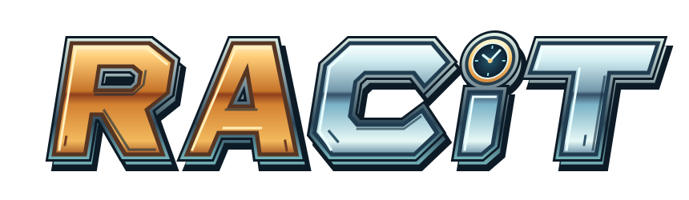
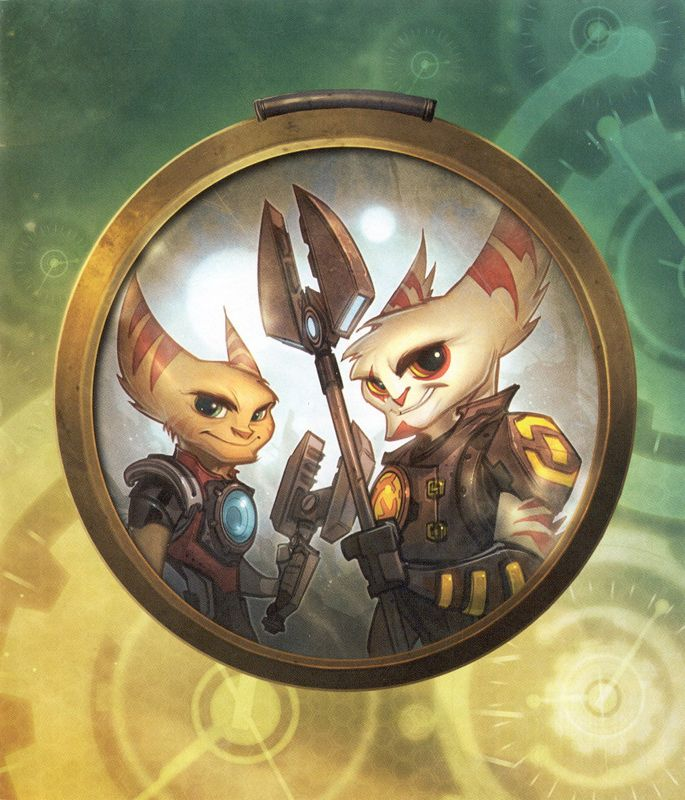

<h1 align="center">
  
</h1>

<h3 align="center"><a href="https://discord.gg/p6rypUkvb">Join the discord for updates!</a></h3>

  

## Ratchet's adventure. A new way back.

A favorite adventure deserves another trip through the galaxy. **RACiT** is building a new way back to **Ratchet & Clank: A Crack in Time**, with a static recompilation of the PlayStation 3 game targeting **Windows and Android (ARM64)**.

## Familiar adventure, fresh foundations

- **A new native foundation.** Built on ps3recomp, RACiT lifts the game's PS3 PPU and SPU code into native C/C++.
- **DualSense joins the adventure.** Integration includes the PS5 controller's speaker and triggers.
- **Vulkan at the heart of rendering.** A Vulkan-based RSX renderer forms the project's graphics path.

## Where we're headed

**Windows and Android (ARM64)** are target platforms. A **Windows launcher preview** exists, and a **Linux build** is intended for debugging.

## Bring your own copy

RACiT is an unofficial, personal-use project and ships no game data. You must supply your own decrypted dump of the **North American disc release, title ID `BCUS98124`**, including:

- `EBOOT.ELF`
- `USRDIR`

Detailed installation and launch instructions will be added once confirmed.

## Work in progress

Known issues remain, including a reported level-14 freeze.

RACiT is not affiliated with Sony, Insomniac Games, or the game's rights holders.
