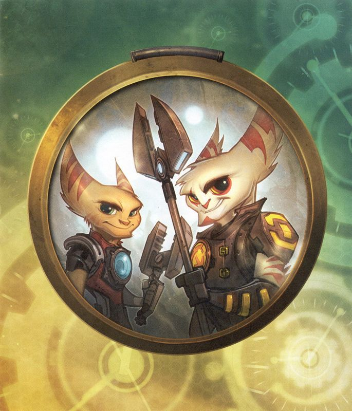

<h1 align="center">
  
</h1>

<h3 align="center"><a href="https://discord.gg/p6rypUkvb">Join the discord for updates!</a></h3>

  

## About

RACiT is Recomped A Crack in Time.

RACiT is a project to bring **Ratchet & Clank: A Crack in Time** (the greatest game ever made) to Windows and Android through static recompilation. It takes the original PS3 code and converts it to native C/C++, using ps3recomp.

The Android target is ARM64. There is also a Linux build for debugging (Linux build not yet public)

## Features

- Vulkan-based RSX renderer
- DualSense (PS5 controller) speaker and trigger mod integrated
- General controller support for most windows compatible controllers.
- Mouse and keyboard controls (bindable in the launcher)
- Added toggles for enhanced internal resolution and graphics settings

## What you'll need

Game data isn't included. You'll need your own decrypted dump of the **North American disc version (`BCUS98124`)**, including:
 !!A LEGALLY DUMPED VERSION OF RATCHET AND CLANK FUTURE: A CRACK IN TIME (NO ASSESTS ARE OR WILL EVER BE INCLUDED WITH THIS PROJECT)!!

- `EBOOT.ELF`
- `USRDIR`

-  After downloading the launcher, extract and run the .exe, which will take you through the setup process, which is importing your .iso directly or directing the launcher to your PS3GAME folder.
 The game will also check for a decrypted EBOOT.elf, if your dumps .elf is showing as encrypted, the easier way to fix is with RPSC3.

## Current status

This is a work in progress.

RACiT is an unofficial project and is not affiliated with Sony, Insomniac Games, or the game's rights holders.
Saves are currently not transferable between windows and android. Feature will be added in the future to sync saves between devices

As of 11/18 Android and MacOS versions are available, along with a windows build for Into The Nexus.

## Settings

Every setting is in the launcher's Settings screen, and most of them are also in the in-game menu: press **F1** (or **Esc** when keyboard and mouse play is off), or **L3+R3** on a controller. On Android, hold Select. Changes made in either place are saved to the same `settings.txt`, so the other one sees them too. Each setting is a `NAME=value` line in that file if you'd rather edit it by hand. The names are in the tables below.

### Display

| Setting | Name in settings.txt | Default | What it does |
| --- | --- | --- | --- |
| Display mode | `RACACIT_DISPLAY_MODE` | Windowed | Windowed, borderless fullscreen or exclusive fullscreen. On 144 or 165 Hz monitors exclusive fullscreen switches the display to 120 Hz so every frame shows for the same time. F11 or Alt+Enter toggles fullscreen. |
| Window size | `RACACIT_WINDOW_SIZE` | Default | Starting window size, from 1280x720 to 3840x2160. |
| VSync | `RACACIT_PRESENT_MODE` | Off (no tearing) | Off without tearing (`mailbox`), on (`fifo`), or off with tearing allowed (`immediate`, lowest latency). |
| Aspect ratio | `RACACIT_ASPECT` | 16:9 | Keep 16:9 with black bars, or stretch to fill the window. |
| Field of view | `RACACIT_FOV` | 100% | 75% to 150% of the game's own field of view (in-game menu). |
| Camera distance | `RACACIT_CAM_DIST` | 100% | 50% to 200% of the game's camera distance (in-game menu). |

### Graphics

| Setting | Name in settings.txt | Default | What it does |
| --- | --- | --- | --- |
| Graphics preset | (sets the ones below) | | In the in-game menu, sets resolution, filtering and texture quality together. Changing any of them shows Custom. |
| Internal resolution | `RACACIT_RES_SCALE` | 1x (960x704, as on the PS3) | 0.5x to 4x. Higher is sharper and costs GPU time. |
| Upscaling | `RACACIT_UPSCALE` | Bilinear | How the image is scaled to the window: bilinear, sharp (bicubic plus sharpening) or nearest (pixelated). |
| Sharpness | `RACACIT_SHARPNESS` | 50% | Sharpening strength, 0 to 10 (0% to 100%). |
| Brightness | `RACACIT_BRIGHTNESS` | Default (0) | -5 to +5. |
| Texture quality | `RACACIT_TEX_QUALITY` | High (original) | Medium and low use smaller textures, for GPUs low on memory. Takes effect after a restart. |
| Anisotropic filtering | `RACACIT_ANISO` | Off | 2x to 16x, sharper textures at an angle. |
| Trilinear filtering | `RACACIT_TRILINEAR` | Off | Smoother blending between texture sizes. |

### Performance

| Setting | Name in settings.txt | Default | What it does |
| --- | --- | --- | --- |
| Frame pacing | `RACACIT_PRESENT_PACE` | On | Holds each finished frame for a moment so frames reach the screen evenly at 60 Hz, which helps when the frame rate is steady but motion looks jumpy. It can cost frame rate when the GPU side is busy (update 1.20 on some Macs drops from about 60 to about 34 with it on), so if you're under 60 fps try turning it off. `0` is off, `1` is on. |
| Frame rate | `RACACIT_FPS_CAP` | 60 fps | The game's frame limiter. 60 is the normal game. `30` is a steady 30 fps for PCs that can't hold 60 (USA disc and update 1.20), with game speed and sound unchanged. See Advanced below for going above 60. |
| CPU usage | `RACACIT_CPU_MODE` | Efficient | Maximum keeps worker threads spinning on every core instead of sleeping. Can help on some CPUs, uses more power and heat. |
| Game build | `RACACIT_GAME_BUILD` | Automatic | Windows only. Which program Play starts: the standard one (AVX2 processors) or the one for older processors. Automatic picks by your CPU. |
| Frame rate (Into the Nexus) | `NEXUS_FPS` | 60 fps | Into the Nexus only. `30` is the game's own 30 fps mode, as on the PS3. |

### Controller

| Setting | Name in settings.txt | Default | What it does |
| --- | --- | --- | --- |
| Bumpers and triggers | `RACACIT_SWAP_SHOULDERS` | As on the PS3 | Swaps L1/R1 with L2/R2. |
| Fire button | `RACACIT_DS_SWAP` | R2 / RT | Fire with R2 (R1 and R2 swapped), or `0` for R1 as on the PS3. |
| Rumble | `RACACIT_DS_RUMBLE` | 100% | Rumble strength, 0 (off) to 100. |
| Adaptive triggers | `RACACIT_DS_TRIGGERS` | On | DualSense trigger resistance. |
| Trigger strength | `RACACIT_DS_TRIG_STR` | 100% | 10% to 100%. |

Buttons can be remapped in the launcher (`RACACIT_PAD_<BUTTON>` lines).

### DualSense controller

| Setting | Name in settings.txt | Default | What it does |
| --- | --- | --- | --- |
| Controller speaker | `RACACIT_DS_SPEAKER` | On | Routes the game's controller audio to the DualSense speaker. |
| Speaker volume | `RACACIT_DS_SPK_VOL` | 49% | 0 to 100. |
| Haptic feedback | `RACACIT_DS_HAPTICS` | On | DualSense haptics. Off uses the plain rumble motors. |
| Haptic strength | `RACACIT_DS_HAPTIC_VOL` | 50% | 0 to 100. |
| Light bar | `RACACIT_DS_LIGHT` | On | Off turns the DualSense light bar off. |
| Motion sensors | `RACACIT_DS_MOTION` | On | Sends the DualSense motion sensors to the game as the PS3 controller's tilt. Off reads as a controller at rest. |

### Keyboard and mouse

| Setting | Name in settings.txt | Default | What it does |
| --- | --- | --- | --- |
| Play with keyboard and mouse | `RACACIT_KBM` | On | Keyboard and mouse controls. Keys are bindable in the launcher (`RACACIT_BIND_<BUTTON>` lines). |
| Mouse sensitivity | `RACACIT_MOUSE_SENS` | 100% | 25% to 400%. |
| Invert mouse Y | `RACACIT_MOUSE_INVERT_Y` | Off | |

### Game

| Setting | Name in settings.txt | Default | What it does |
| --- | --- | --- | --- |
| Language | `RACACIT_LANGUAGE` | English | The disc's own translations: `fr`, `es`, `de`, `it`, `nl`. |
| Logos and notices at boot | `RACACIT_SKIP_INTRO` | Show | Skips the startup logos and notices. |
| PRESS START screen | `RACACIT_SKIP_PRESS_START` | Show | Skips the title screen (with logos skipped). |
| START skips movies | `RACACIT_START_SKIPS_MOVIES` | Yes | START skips a movie. |
| Every cutscene skippable | `RACACIT_ALL_CUTSCENES_SKIPPABLE` | Yes | Lets you skip cutscenes the game normally doesn't let you skip. |
| Land anywhere in space | `RACACIT_SPACE_FREE_LANDING` | Yes | Every moon and planet in space can be landed on without waiting for the story to unlock it. Off keeps the original story lock. |
| Tools of Destruction discount | `RACACIT_TOD_DISCOUNT` | On | The game's discount for Tools of Destruction owners: five weapons cheaper at the vendor. |
| Power pack (pre-order bonus) | `RACACIT_POWER_PACK` | On | More health, the CryoMine Glove and an outfit variant. Off takes the health and outfit back from a save as it loads (the glove stays). |
| Cheat menu | `RACACIT_CHEATS` | Off | A Cheats page in the in-game menu (bolts, weapon levels, god mode, travel) in place of Trophies. No skill points or trophies while it's on, and never again in a save a cheat was used in. |
| Save list screen | `RACACIT_SAVE_UI` | On | The port's own list of saves when loading and saving. Off skips the list and the save is picked without asking. |
| Save slot (Into the Nexus) | `NEXUS_SAVE_SLOT` | Slot 1 | Into the Nexus only. Slots 2 to 8 each keep a save of their own. An empty slot starts a New Game. |
| FPS counter | `RACACIT_FPS` | Off | Frame rate and frame time at the top left. |
| Discord status | `RACACIT_DISCORD` | On | Shows what you're playing in Discord. |
| Clank levels (testing) | `RACACIT_SKIP_CLANK` | Play | Skips the Clank levels. For testing. |

### Advanced (settings.txt only)

These aren't in the menus and are still experimental.

| Name | What it does |
| --- | --- |
| `RACACIT_FPS_CAP` above 60 | Lets the game run past 60 fps with game speed kept at real time, for example `RACACIT_FPS_CAP=120`. Use it with `RACACIT_VBLANK_HZ` and frame pacing off. Some things may still be tied to 60. |
| `RACACIT_VBLANK_HZ` | The console's refresh rate the game sees, 60 by default. Set it to match a frame cap above 60. |
